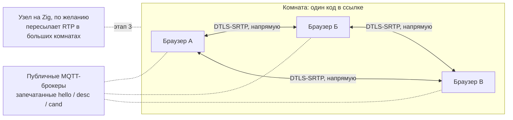

# Звонилка — план

Видеозвонок по ссылке без своих серверов. Страница лежит на GitHub Pages, участники находят друг друга через публичные MQTT-брокеры (сообщения запечатаны ключом из кода комнаты), а звук и видео идут напрямую между ними по WebRTC. Идея и технологии — из RDC; позже к странице добавится медиа-узел на Zig, который делает то же, что сервер LiveKit, только это один маленький бинарник.

Версия плана — 10 ноября 2026. Как звонок выглядит и какими жестами управляется — в [UX.md](UX.md).

## Что получает человек

- Открыл страницу, нажал «Новый звонок», отправил ссылку. Кто открыл ссылку — сразу в звонке: без регистрации, установки и комнаты ожидания.
- В Telegram та же страница открывается как Mini App: ссылка `https://t.me/StartNewCallBot?startapp=<комната>` запускает её прямо в чате и подключает к звонку.
- Камера, микрофон, показ экрана со звуком, сообщения, громкость каждого участника, выбор устройств. Кнопок пять; остальное делается жестами, знакомыми по галерее и плееру: коснулся человека — он крупно, щипок — приблизить, зажал и повёл — его громкость, удержал микрофон — сказал пару слов.
- Каждая пара участников соединена напрямую. Медиа шифрует сам WebRTC — от участника до участника; брокеры видят только случайную тему и шифртекст.

## Как это устроено

- **Комната.** Это строка в ссылке: `…/#<комната>` в браузере или `?startapp=<комната>` в Telegram. «Новый звонок» делает случайный код из 16 букв и цифр (82 бита); можно задать и свой — `#планёрка`, `#1234`, — но короткий код легко угадать. Из строки через HKDF-SHA256 получаются 48 байт: тема брокера `zvonilka/<32 hex>` и ключ AES-256-GCM.
- **Поиск друг друга.** Каждый участник держит соединения MQTT поверх WebSocket с broker.emqx.io и broker.hivemq.com и публикует в тему комнаты запечатанные сообщения: `hello` при входе и раз в 20 секунд, `desc` (offer или answer) и `cand` конкретному участнику, `bye`. В каждом сообщении — случайный идентификатор отправителя и счётчик; уже виденный счётчик отбрасывается, так что не проходит ни вторая копия через другой брокер, ни повтор записанного сообщения.
- **Кто кому звонит.** Из двух участников offer делает тот, у кого идентификатор меньше; второй отвечает или говорит `hello` в ответ, если первый его ещё не заметил. Одно правило — встречных вызовов не бывает.
- **Соединения.** На каждую пару — один `RTCPeerConnection` с публичными STUN (Google, Cloudflare), trickle ICE и пятью постоянными каналами: микрофон, камера, экран, звук экрана и канал данных. Включить или выключить микрофон, камеру и показ экрана — значит подменить дорожку в своём канале; пересогласование не нужно, поэтому это мгновенно. Выключенный микрофон не передаётся вовсе — ни звука, ни тишины. Когда канал данных открыт, всё остальное (состояние микрофона, чат, перезапуск ICE) идёт по нему; брокеры нужны только для первого контакта и переподключения.
- **Качество.** В сетке каждый шлёт поток каждому, поэтому страница снижает битрейт и разрешение камеры по мере роста комнаты: около 2 Мбит/с и 720p на двоих, 380 кбит/с и 360p на пятерых и больше. Предел — 8 человек; на телефонах удобно до пяти.
- **Без ретранслятора.** Если сети с обеих сторон не пропускают прямой путь (симметричный NAT у обоих), эта пара не соединится — плитка так и скажет. Этап 3 решает это без нашего сервера.

## В сравнении с LiveKit и Meet

| | Звонилка | LiveKit / Meet |
|---|---|---|
| Сервер | нет: Pages, публичные брокеры, прямые соединения | кластер SFU, TURN, сигналинг, учётные записи |
| От двух до пяти человек | прямой путь — меньше задержки не бывает | каждый пакет идёт через сервер |
| Шифрование | сквозное по построению | до сервера, если не включить E2EE отдельно |
| Большие комнаты | этап 3: узел на Zig, который может запустить кто угодно | есть сразу |
| Вход | открыть ссылку | открыть ссылку (в Meet создателю нужен аккаунт) |

Браузеры умеют WebRTC сами, поэтому в прямом звонке наш код к медиа не прикасается: страница — на JavaScript, а Zig нужен там, где участник не браузер, — в медиа-узле.

## Этапы

1. **Страница звонка.** `web/` — статическая страница без сборки и зависимостей. `call.js` — сам звонок без интерфейса: комнаты по ссылке и коду, сигналинг, сетка P2P, микрофон, камера, показ экрана со звуком, сообщения, переподключение. `ui.js` и `style.css` — интерфейс: плитки, раскладка, жесты, громкость участников, подсказки ([UX.md](UX.md)). Живой тест в headless Chrome — `tools/call_test.mjs`. **Сделано.**
2. **Telegram Mini App.** Страница узнаёт Telegram, берёт комнату из стартового параметра и имя из профиля, подключается сразу, приглашает через Telegram, слушает кнопку «Назад» в его шапке, а там, где встроенный браузер не даёт камеру или микрофон, предлагает открыть звонок в обычном браузере. Код готов; на настоящих телефонах внутри Telegram ещё не проверено. Боту `@StartNewCallBot` в BotFather задаётся адрес Mini App (Bot Settings → Configure Mini App). Токен бота странице не нужен. Инлайн-приглашения (`@StartNewCallBot код` в любом чате) шлёт `bot/bot.mjs` — маленький процесс без зависимостей; без него приглашают обычной ссылкой.
3. **Медиа-узел на Zig.** Отдельная программа входит в комнату как пересылающий участник. Сетевой стек берём из RDC (`src/net/`: STUN и ICE, DTLS 1.2, SCTP, SDP, сигналинг через MQTT) и добавляем DTLS-SRTP (расширение `use_srtp` и вывод ключей), `srtp.zig` (AES-CM с HMAC-SHA1 и AES-GCM), `rtp.zig` и `rtcp.zig`, медиа-секции в SDP и `sfu.zig` — пересылку без перекодирования, кэш для повторов по NACK, передачу запросов ключевого кадра, выбор слоя simulcast под каждого получателя. Когда узел в комнате, страница переходит от сетки к звезде: один исходящий поток, N входящих. Узел с доступным адресом соединяет и те пары, что не могут напрямую. Цель — 50 человек в комнате на одном ядре, бинарник до 2 МБ.
4. **Больше от узла.** Запись без перекодирования, показ экрана компьютера с системным звуком прямо из RDC, ИИ-агент в звонке через MCP.
5. **Пересылка через участника.** Для пары без прямого пути и без узла: третий участник пересылает их медиа.

## Решения

- Проект — «Звонилка», репозиторий `ANODs/Zvonilka`; всё по-русски: интерфейс, документация, комментарии, сообщения коммитов.
- Своих серверов нет: публичные MQTT-брокеры для первого контакта, прямые соединения для всего остального.
- Страница — на чистом JavaScript без сборки; Zig — для медиа-узла (этап 3).
- Интерфейс: на экране люди, а не кнопки; всё редкое — жестом или в одном листе ([UX.md](UX.md)).
- Комната — строка в ссылке; регистр не важен; в Telegram она же стартовый параметр.
- Вход без комнаты ожидания: ссылка подключает сразу, микрофон включён, камера — как её оставили в прошлый раз (в первый раз включена).
- Прежняя версия на LiveKit (Next.js: `app/`, `Dockerfile`, `telegram-bot.js`) лежит рядом и не тронута, пока новая её не заменит.

## Проверка

- `node tools/call_test.mjs` — три участника в headless Chrome (компьютер, телефон, компьютер) через настоящие брокеры: все соединяются со всеми, идут кадры и звук, выключенный микрофон не передаётся, сообщения и показ экрана доходят, жесты пальцами и мышью делают своё дело, участник выходит, возвращается и закрывает вкладку. С ключом `--shots <папка>` камеры заменяются нарисованными людьми и сохраняются снимки экранов.
- Вручную: два телефона в разных сетях по ссылке; та же ссылка внутри Telegram.
