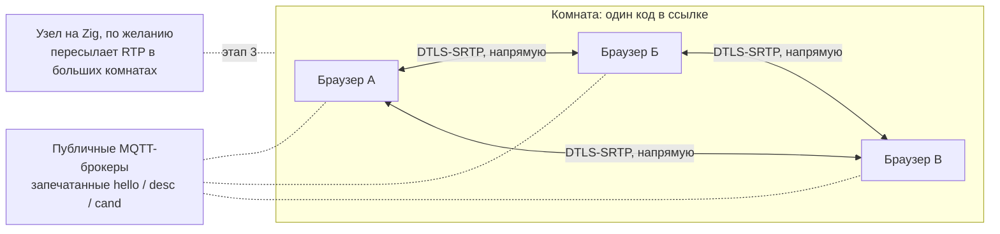

# Звонилка — план

Видеозвонок по ссылке без своих серверов. Страница лежит на GitHub Pages, участники находят друг друга через публичные MQTT-брокеры (сообщения запечатаны ключом из кода комнаты), а звук и видео идут напрямую между ними по WebRTC. Идея и технологии — из RDC; позже к странице добавится медиа-узел на Zig, который делает то же, что сервер LiveKit, только это один маленький бинарник.

Версия плана — 10 ноября 2026. Как звонок выглядит и какими жестами управляется — в [UX.md](UX.md).

## Что получает человек

- Открыл страницу, нажал «Новый звонок», отправил ссылку. Кто открыл ссылку — сразу в звонке: без регистрации, установки и комнаты ожидания.
- В Telegram та же страница открывается как Mini App: ссылка `https://t.me/StartNewCallBot?startapp=<комната>` запускает её прямо в чате и подключает к звонку.
- Камера, микрофон, показ экрана со звуком, сообщения, громкость каждого участника, выбор устройств. Кнопок пять; остальное делается жестами, знакомыми по галерее и плееру: коснулся человека — он крупно, щипок — приблизить, зажал и повёл — его громкость, удержал микрофон — сказал пару слов.
- Каждая пара участников соединена напрямую. Медиа шифрует сам WebRTC — от участника до участника; брокеры видят только случайную тему и шифртекст.

## Как это устроено



- **Комната.** Это строка в ссылке: `…/#<комната>` в браузере или `?startapp=<комната>` в Telegram. «Новый звонок» делает случайный код из 16 букв и цифр (82 бита); можно задать и свой — `#планёрка`, `#1234`, — но короткий код легко угадать. Из строки через HKDF-SHA256 получаются 48 байт: тема брокера `zvonilka/<32 hex>` и ключ AES-256-GCM.
- **Поиск друг друга.** Каждый участник держит соединения MQTT поверх WebSocket с broker.emqx.io и broker.hivemq.com и публикует в тему комнаты запечатанные сообщения: `hello` при входе и раз в 20 секунд, `desc` (offer или answer) и `cand` конкретному участнику, `bye`. В каждом сообщении — случайный идентификатор отправителя и счётчик; уже виденный счётчик отбрасывается, так что не проходит ни вторая копия через другой брокер, ни повтор записанного сообщения.
- **Кто кому звонит.** Из двух участников offer делает тот, у кого идентификатор меньше; второй отвечает или говорит `hello` в ответ, если первый его ещё не заметил. Одно правило — встречных вызовов не бывает.
- **Соединения.** На каждую пару — один `RTCPeerConnection` с публичными STUN (Google, Cloudflare), trickle ICE и пятью постоянными каналами: микрофон, камера, экран, звук экрана и канал данных. Включить или выключить микрофон, камеру и показ экрана — значит подменить дорожку в своём канале; пересогласование не нужно, поэтому это мгновенно. Выключенный микрофон не передаётся вовсе — ни звука, ни тишины. Когда канал данных открыт, всё остальное (состояние микрофона, чат, перезапуск ICE) идёт по нему; брокеры нужны только для первого контакта и переподключения.
- **Качество.** В сетке каждый шлёт поток каждому, поэтому страница снижает битрейт и разрешение камеры по мере роста комнаты: около 2 Мбит/с и 720p на двоих, 380 кбит/с и 360p на пятерых и больше. Предел — 8 человек; на телефонах удобно до пяти.
- **Без ретранслятора.** Если сети с обеих сторон не пропускают прямой путь (симметричный NAT у обоих), эта пара не соединится — плитка так и скажет. Этап 3 решает это без нашего сервера.

## В сравнении с LiveKit и Meet

| | Звонилка | LiveKit / Meet |
|---|---|---|
| Сервер | нет: Pages, публичные брокеры, прямые соединения | кластер SFU, TURN, сигналинг, учётные записи |
| От двух до пяти человек | прямой путь — меньше задержки не бывает | каждый пакет идёт через сервер |
| Шифрование | сквозное по построению | до сервера, если не включить E2EE отдельно |
| Большие комнаты | этап 3: узел на Zig, который может запустить кто угодно | есть сразу |
| Вход | открыть ссылку | открыть ссылку (в Meet создателю нужен аккаунт) |

Браузеры умеют WebRTC сами, поэтому в прямом звонке наш код к медиа не прикасается: страница — на JavaScript, а Zig нужен там, где участник не браузер, — в медиа-узле.

## Этапы

1. **Страница звонка.** `web/` — статическая страница без сборки и зависимостей. `call.js` — сам звонок без интерфейса: комнаты по ссылке и коду, сигналинг, сетка P2P, микрофон, камера, показ экрана со звуком, сообщения, переподключение. `ui.js` и `style.css` — интерфейс: плитки, раскладка, жесты, громкость участников, подсказки ([UX.md](UX.md)). Живой тест в headless Chrome — `tools/call_test.mjs`. **Сделано.**
2. **Telegram Mini App.** Страница узнаёт Telegram, берёт комнату из стартового параметра и имя из профиля, подключается сразу, приглашает через Telegram, слушает кнопку «Назад» в его шапке, а там, где встроенный браузер не даёт камеру или микрофон, предлагает открыть звонок в обычном браузере. Код готов; на настоящих телефонах внутри Telegram ещё не проверено. Боту `@StartNewCallBot` в BotFather задаётся адрес Mini App (Bot Settings → Configure Mini App). Токен бота странице не нужен. Инлайн-приглашения (`@StartNewCallBot код` в любом чате) шлёт `bot/bot.mjs` — маленький процесс без зависимостей; без него приглашают обычной ссылкой.
3. **Медиа-узел на Zig.** Отдельная программа входит в комнату как пересылающий участник. Сетевой стек берём из RDC (`src/net/`: STUN и ICE, DTLS 1.2, SCTP, SDP, сигналинг через MQTT) и добавляем DTLS-SRTP (расширение `use_srtp` и вывод ключей), `srtp.zig` (AES-CM с HMAC-SHA1 и AES-GCM), `rtp.zig` и `rtcp.zig`, медиа-секции в SDP и `sfu.zig` — пересылку без перекодирования, кэш для повторов по NACK, передачу запросов ключевого кадра, выбор слоя simulcast под каждого получателя. Когда узел в комнате, страница переходит от сетки к звезде: один исходящий поток, N входящих. Узел с доступным адресом соединяет и те пары, что не могут напрямую. Цель — 50 человек в комнате на одном ядре, бинарник до 2 МБ. **Первая веха сделана** (раздел «Медиа-узел»): узел в `node/` входит в комнату, и участники соединяются только через него; один исходящий поток на всех — следующая веха.
4. **Больше от узла.** Запись без перекодирования, показ экрана компьютера с системным звуком прямо из RDC, ИИ-агент в звонке через MCP.
5. **Пересылка через участника.** Для пары без прямого пути и без узла: третий участник пересылает их медиа.

## Медиа-узел

Программа на Zig в `node/` — один бинарник `zvonilka-node` без зависимостей (0,6 МБ в сборке на размер). Ей дают код комнаты или ссылку на звонок; узел входит в комнату, как страница, и пересылает, пока его не остановят.

- **Как узел объявляет себя.** Тем же `hello`, что и участник, с полем `node` — версией роли узла (сейчас 1):

  ```json
  {"v":1,"f":"<16 hex>","n":<счётчик>,"t":"hello","node":1,"name":"Узел"}
  ```

  Всем — при входе и раз в 20 секунд; тому, кто только что вошёл, — сразу в ответ на его `hello`, с полем `to`. Уходя, узел шлёт `bye`. По полю `node` страница понимает, что это не человек: плитки у узла нет. Из двух узлов все выбирают тот, чей идентификатор меньше. Узла не слышно 45 секунд — его больше нет; если же соединение через узел оборвалось, страница спрашивает его сразу (своим `hello`) и, не получив ответа за три секунды, возвращается к прямым соединениям.
- **Сетка → звезда.** Пока узел в комнате, страница строит с участниками те же соединения с пятью каналами, но не напрямую: offer для участника Б она шлёт узлу — `desc`, где `to` — узел, а `peer` — Б. Узел отвечает `desc` с тем же `peer`; его кандидаты записаны прямо в answer. Кандидаты страницы идут так же — `cand` с `peer`. Звонит узлу всегда страница, поэтому встречных вызовов нет; прямые `desc` и `cand` от участников страница в это время не слушает. Узел появился или ушёл — страница закрывает соединения и строит их заново по новому пути.
- **Плечи и пары.** Соединение страницы А с узлом ради участника Б — плечо. Когда плечо ради А построил и Б, узел сводит их в пару и пересылает между ними RTP, RTCP и сообщения канала данных. Пересылка прозрачная: пакеты идут с теми же номерами и метками времени; узел расшифровывает SRTP одного плеча, переводит номера потоков (SSRC), типов нагрузки и расширений заголовка — у каждого плеча они свои — и шифрует ключами другого. Поэтому потери и повторы (NACK, rtx), запросы ключевого кадра (PLI, FIR) и оценка полосы (transport-cc, REMB) остаются делом двух браузеров, а узлу не нужны ни буфер, ни кэш. Сведя пару, узел сам просит ключевой кадр у того, кто начал слать раньше. Плечо закрылось — узел закрывает и парное: уход собеседника виден так же, как при прямом соединении.
- **О чём узел договаривается.** На любом плече — только о том, что умеет каждый браузер: Opus и VP8 с повторами (rtx); так у двух плеч всегда один кодек. Расширения заголовка — те, что имеют смысл от браузера до браузера: MID, уровень звука, abs-send-time, transport-cc, поворот видео, playout-delay, video-content-type, video-timing, color-space. DTLS 1.2, узел всегда сервер. SRTP — AES-GCM, а если браузер его не предлагает — AES-CM-128 с HMAC-SHA1-80 (ключ `--srtp cm|gcm` оставляет один профиль). Медиа и каналы данных всех плеч идут через один порт UDP (`--port`); браузерам узел объявляет адреса своих сетевых интерфейсов и тот, каким он виден снаружи (STUN), а `--ip` добавляет заданный.
- **Сигналинг.** Тот же, что у страницы: тема и ключ из кода комнаты, MQTT 3.1.1 поверх WebSocket и TLS к тем же двум брокерам, счётчик сообщений у каждого отправителя. Ключ `--tcp` — запасной путь без TLS (порт 1883) для машины без корневых сертификатов; сообщения запечатаны и там.
- **Доверие.** Узел расшифровывает медиа одного плеча и шифрует для другого: с узлом шифрование идёт от браузера до узла, а не от участника до участника. Объявить себя узлом может любой, у кого есть код комнаты, — как и войти в звонок; но плитки у узла нет, и страница пока не показывает, что звонок идёт через него.
- **Что где.** `node/src/`: `signal.zig`, `mqtt.zig`, `ws.zig` — сигналинг; `stun.zig`, `sdp.zig`, `dtls.zig` (с `use_srtp` и выводом ключей), `srtp.zig`, `rtp.zig`, `rtcp.zig`, `sctp.zig` — протоколы; `leg.zig` — плечо; `node.zig` — комната, пары и пересылка; `netif.zig`, `room.zig`, `main.zig`. STUN, DTLS, SCTP и MQTT взяты из RDC и дополнены.

### Первая веха — 10 ноября 2026

- **Сделано.** Узел входит в комнату по коду; с Chrome устанавливает ICE, DTLS 1.2 с `use_srtp`, SRTP и SRTCP в обоих профилях, SCTP с каналом данных `zvonilka`; разбирает offer страницы и собирает answer на пять каналов; пересылает звук, видео, показ экрана и сообщения между участниками; передаёт PLI, FIR, NACK и отчёты; переживает перезапуск ICE. Страница переходит от сетки к звезде и обратно.
- **Проверено.** `zig build test` — 62 теста: поток ключа и вывод ключей из RFC 3711 (приложения B.2 и B.3), пакеты SRTP и SRTCP из набора тестов libsrtp для обоих профилей, второй круг номеров пакетов, пересылка между двумя плечами с разной нумерацией (как у Chrome и Firefox) без браузера, испорченные описания сеанса и случайные датаграммы. `node tools/node_test.mjs` — 37 шагов в headless Chrome через настоящие брокеры: двое соединяются напрямую, узел входит — и оба получают друг от друга звук и видео только через него; запрос ключевого кадра доходит до отправителя, и кадр приходит; сообщения, выключенный микрофон, показ экрана, перезапуск ICE, третий участник, слушатель без камеры и микрофона, закрытая вкладка, выход и возвращение; узел уходит — снова напрямую; потерянные пакеты допрашиваются и приходят повторами; узел убит без прощания — страницы сами соединяются напрямую (в проверке — за 13–16 секунд). Долгая проверка (`--soak`) в обоих профилях: 22 минуты разговора, номера пакетов звука и видео прошли полный круг, узел переслал 343 тысячи пакетов RTP и не отбросил ни одного. Проверка идёт и на сборках `-Doptimize=small` и `safe`. `node tools/call_test.mjs` — прежние 57 шагов без узла.
- **Не сделано.** Один исходящий поток: сейчас у каждой пары своё плечо, и страница шлёт свой поток в каждое — звезда по путям, а не по числу потоков, так что предел в восемь человек остаётся. Для него узлу нужны своя оценка полосы на каждого получателя, кэш для повторов и выбор слоя simulcast — это и есть `sfu.zig`. Другие кодеки, кроме Opus и VP8. Знак на странице, что звонок идёт через узел, и сквозное шифрование кадров, при котором узел пересылал бы их, не видя. Не проверено: в настоящих сетях (узел за NAT и на сервере с внешним адресом), с Firefox и Safari, на Linux (собирается под x86_64 и arm64, не запускался).

## Решения

- Проект — «Звонилка», репозиторий `ANODs/Zvonilka`; всё по-русски: интерфейс, документация, комментарии, сообщения коммитов.
- Своих серверов нет: публичные MQTT-брокеры для первого контакта, прямые соединения для всего остального.
- Страница — на чистом JavaScript без сборки; Zig — для медиа-узла (этап 3).
- Интерфейс: на экране люди, а не кнопки; всё редкое — жестом или в одном листе ([UX.md](UX.md)).
- Комната — строка в ссылке; регистр не важен; в Telegram она же стартовый параметр.
- Вход без комнаты ожидания: ссылка подключает сразу, микрофон включён, камера — как её оставили в прошлый раз (в первый раз включена).
- Прежняя версия на LiveKit (Next.js: `app/`, `Dockerfile`, `telegram-bot.js`) лежит рядом и не тронута, пока новая её не заменит.

## Проверка

- `node tools/call_test.mjs` — три участника в headless Chrome (компьютер, телефон, компьютер) через настоящие брокеры: все соединяются со всеми, идут кадры и звук, выключенный микрофон не передаётся, сообщения и показ экрана доходят, жесты пальцами и мышью делают своё дело, участник выходит, возвращается и закрывает вкладку. С ключом `--shots <папка>` камеры заменяются нарисованными людьми и сохраняются снимки экранов.
- `node tools/node_test.mjs` — то же через медиа-узел (сначала `cd node && zig build`): участники соединяются только через узел, получают друг от друга звук и видео, запросы ключевого кадра и повторов доходят, узел приходит и уходит посреди звонка. С ключом `--soak cm|gcm` — долгая проверка: двое говорят через узел, пока номера пакетов не пройдут полный круг.
- Вручную: два телефона в разных сетях по ссылке; та же ссылка внутри Telegram.
